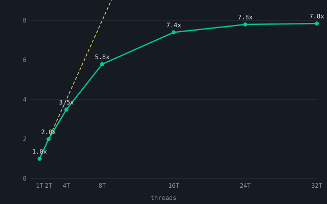
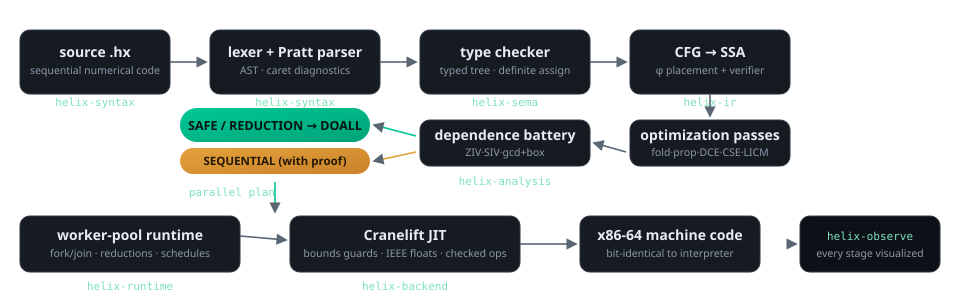
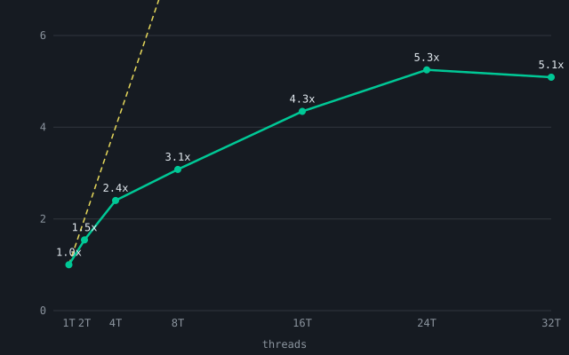
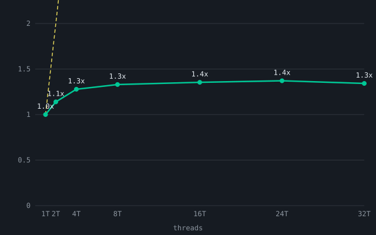

<div align="center">

# HELIX Lite

**An automatic parallelizing compiler that shows you the proof.**

Write ordinary sequential numerical code. HELIX proves which loops are safe to
spread across the machine's cores when they are large enough to pay for
threading — and shows you the dependence analysis behind every verdict.



</div>

```helix
fn main() {
    let n = 50000000;
    let a: [f64] = zeros(n);
    let out: [f64] = zeros(n);
    for i in 0..n {
        out[i] = a[i] * 5.0 + 1.0;
    }
}
```

```
$ helix loops examples/scale.hx
==== main loop analysis ====
Loop #1: RAW 0 / WAR 0 / WAW 0 => SAFE
    READ a[i]
    WRITE out[i]

$ helix loops examples/recurrence_reject.hx
==== main loop analysis ====
Loop #1: RAW 1 / WAR 0 / WAW 0 => SEQUENTIAL (RAW a[i] <- a[i - 1] (carried by iteration distance 1, level 1))
    READ a[i - 1]
    WRITE a[i]
```

A loop that *can* be proven independent is proposed for parallel execution across
the machine's cores, and threads for real once the loop is large enough to pay
for the fork/join. A loop that carries a dependence — like the recurrence above
— is **refused, with the exact distance and direction printed as evidence**.

---

## The pipeline



source → lexer → Pratt parser → AST → type checker → CFG IR → SSA (semi-pruned,
CHK dominators) → constant folding/propagation · copy-prop · DCE · CSE · LICM →
loop detection → **dependence battery (ZIV · SIV family · gcd+bounded-box)** →
parallelization (DOALL + reduction recognition) → Cranelift → x86-64 machine code.

Every stage is inspectable: `helix dump tokens|ast|ir|ssa`, or the whole pipeline
stepped through visually in the Observatory (`helix observe`).

## Measured results (laptop, 2026-10-11, post-hardening — i9-13900HX, 32 threads)

| Claim | Number |
|---|---|
| saxpy @16M f64, parallel speedup | **5.79× @ 8 threads**, peak **7.84× @ 32T** (bandwidth-bound) |
| dot-product reduction @4M | **3.08× @ 8 threads**, peak 5.25× @ 24T |
| matmul 128², interpreter → native seq | **204×** (1199 ms → 5.9 ms) |
| jacobi stencil 512², interpreter → native seq | **180×** (3097 ms → 17 ms) |
| parallel vs optimized native seq | **wins on long streaming loops** (saxpy 2.2×, scale 1.86× @16M); honestly LOSES on mid-size multi-array kernels (per-access dispatch overhead — see results.md) |
| recurrence loop | **refused** — carried dependence proven, runs sequential |
| sieve inner sweep | **refused** — stride not provably non-zero (sound, conservative) |
| cross-backend correctness | interp ≡ JIT on the FULL state (printed lines + final arrays); FP reductions match under ε = 1e-9 (parallel reordering) |

Full tables + methodology: [docs/benchmarks/results.md](docs/benchmarks/results.md).
The pre-hardening campaign is preserved at
[docs/benchmarks/data/pre-hardening/](docs/benchmarks/data/pre-hardening/) with
its provenance note.

### Speedups at a glance

| dot product @4.2M | jacobi stencil @1024² |
|---|---|
|  |  |

*(9 measured kernels × sizes live in [`docs/benchmarks/figs/`](docs/benchmarks/figs).)*

## Try it

**No install needed:** [Open the HELIX Observatory](https://noel-alex.github.io/helix-compiler/) to run the compiler in your browser. Start with **small_n**, inspect the pipeline, then open **BENCH → Measure both engines in browser WASM**. Locally: `cargo run --release -p helix-cli -- observe`.

```bash
# one-time: put `helix` on your PATH (or prefix every command with cargo run --release -p helix-cli --)
cargo install --path crates/helix-cli

helix observe            # the Observatory web UI (blocks this terminal; Ctrl-C to stop)
helix run examples/saxpy.hx                    # interpreter
helix run --backend jit examples/saxpy.hx      # JIT (identical output)
helix selftest           # differential gauntlet
```

Handy controls:

```bash
helix run --backend jit --threads 4 examples/saxpy.hx   # pin the thread count
helix bench --quick                                     # smoke pass: smallest size per kernel, 5 samples
HELIX_SCHEDULE=guided helix run --backend jit f.hx      # pick the schedule
```

New to the project? The five-minute tour is in [docs/guide.md](docs/guide.md).

## Run it in your browser

The browser lab compiles the same optimized SSA IR the local pipeline produces to a real WebAssembly module (Cranelift cannot target wasm, so emission is its own stage) and executes that module beside the reference interpreter with printed-line and FNV checksum parity — the checksum stream is every printed line plus the arrays still visible at the end of `main`, the interpreter's definition. The native Cranelift JIT and the multicore parallel runtime remain host-only features of the local Observatory.

Large bundled inputs skip browser execution to keep the page responsive; their recorded native campaign remains inspectable. Browser measurement labels state their timing scopes: interpreter samples include parsing/checking and checksum, while compiled samples time execution after compilation and exclude the final-array checksum.

## Layout

| Path | What |
|---|---|
| crates/helix-syntax | lexer + parser + AST |
| crates/helix-sema | types, scopes, static checks |
| crates/helix-ir | CFG IR, SSA, optimization passes + verifier |
| crates/helix-analysis | loops, dependence battery, parallelization plans |
| crates/helix-backend | Cranelift lowering + JIT engine + parallel regions |
| crates/helix-runtime | worker pool, schedules, reductions |
| crates/helix-engine | reference interpreter |
| crates/helix-bench | benchmark harness + kernel suite |
| crates/helix-observe | Observatory HTTP server + CFG layout/DOT rendering |
| crates/helix-artifact | pure compile-artifact builder shared by server + browser |
| crates/helix-wasm-backend | IR→WebAssembly emitter + frozen module ABI |
| crates/helix-wasm | wasm bridge (`helix_apply`); ships `web/wasm/helix-lab.wasm` |
| web/ | Observatory static surface + wasm browser lab |
| docs/ | lab notebook: research digests, decisions, notes, benchmarks, report outline |
| examples/*.hx | demo programs incl. deliberately rejected loops |

License: MIT
